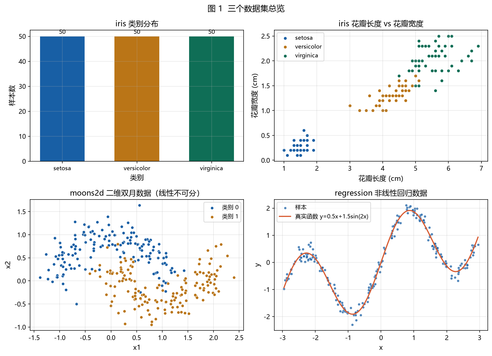
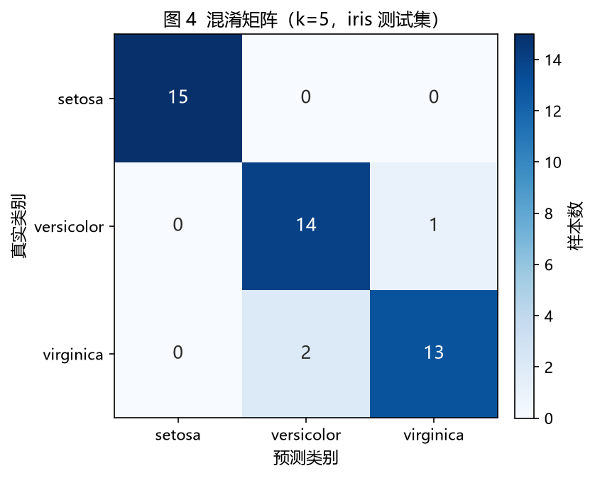
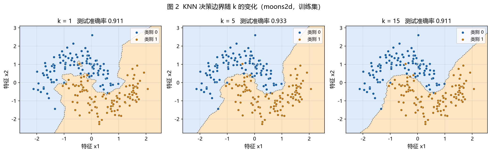
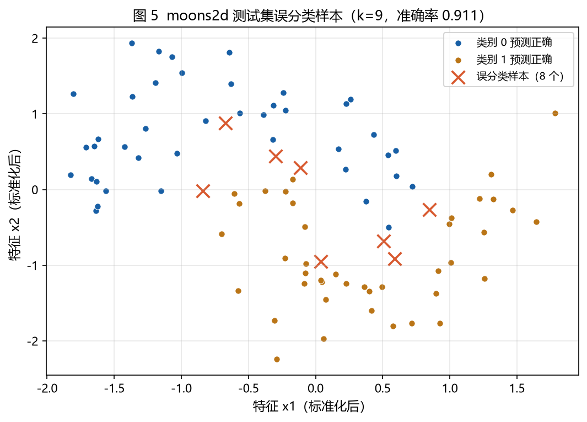
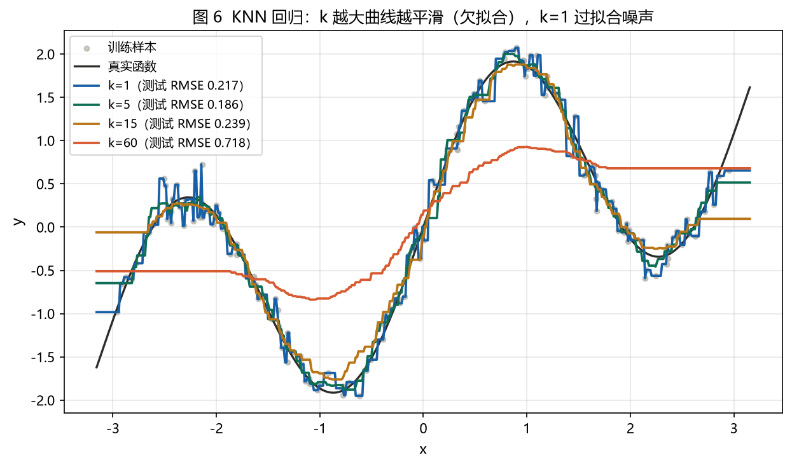
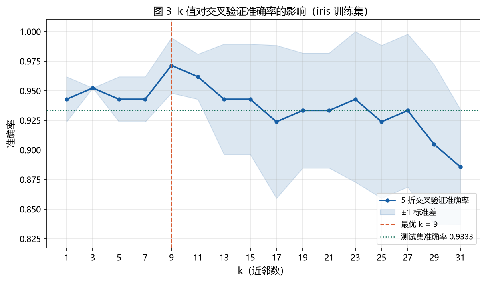
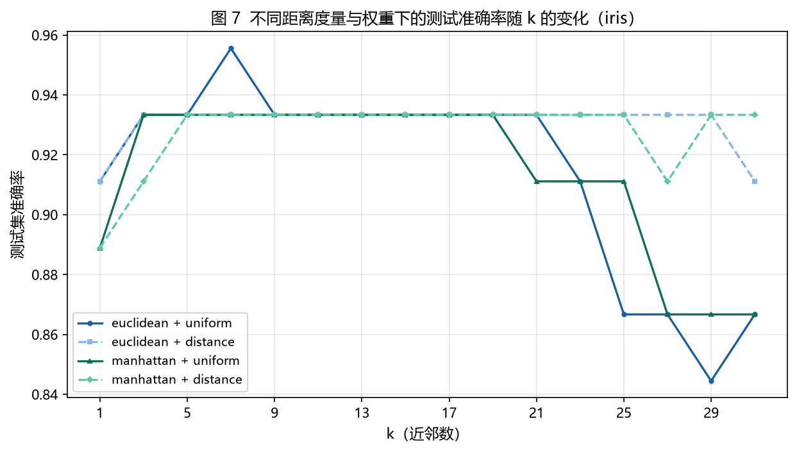
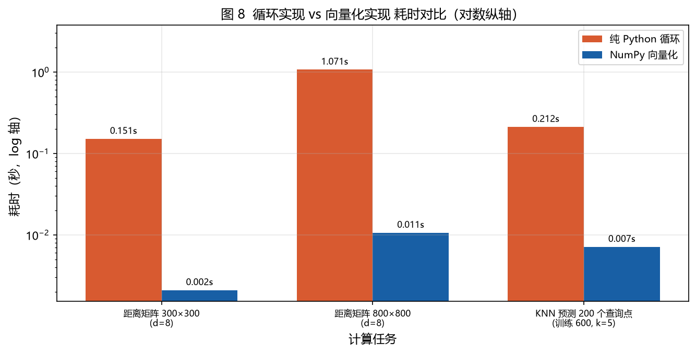

# 实验报告：K 近邻（KNN）算法的从零实现与性能分析

**课程**：人工智能与机器学习  **实践**：第 8 周实践一
**随机种子**：42（全流程统一，结果可完全复现）

---

## 摘要

本实验在不调用任何现成 KNN 库的前提下，用 NumPy 从零实现了 K 近邻分类器与回归器，
并在 iris（分类）、moons2d（二维非线性分类）、regression（非线性回归）三个数据集上
完成了算法验证、参数分析、对照实验与性能优化。

主要结论：

1. iris 上交叉验证选出的最优 k = 9（CV 准确率 0.9714），测试集准确率 **0.9333**，
   优于 k=1 的 0.9111；
2. k 的作用在两个方向上都能观察到 —— k 太小导致决策边界碎裂（过拟合），
   k 太大会把非凸结构"抹平"（欠拟合）；
3. 回归任务上 RMSE 随 k 先降后升，k=5 时最优（RMSE 0.1862，R² 0.9717），
   k=60 时 RMSE 劣化到 0.7176；
4. 与 sklearn 的 `KNeighborsClassifier` 在 20 组配置下预测完全一致，
   唯一语义差异是**平票规则**：sklearn 等价于"取较小标签"，本实现默认"最近邻所属类别胜出"；
5. 向量化实现比纯 Python 双重循环快 **30–100 倍**。

---

## 一、实验目的

1. 掌握 KNN 的算法原理，能手写距离计算、近邻搜索、多数投票与回归预测；
2. 理解 KNN 的参数含义（k、距离度量、权重方式）及其对偏差-方差的影响；
3. 建立正确的实验方法论：训练/测试划分、防数据泄漏的标准化、交叉验证调参；
4. 通过与工业级实现（sklearn）的对照，理解"自己写的"和"生产可用的"差在哪里；
5. 养成工程习惯：模块拆分、异常处理、单元测试、可视化、git 版本管理。

---

## 二、实验环境

| 项目 | 版本 |
|---|---|
| Python | 3.13.14 |
| numpy | 2.5.3 |
| pandas | 3.1.0 |
| matplotlib | 3.11.2 |
| scikit-learn（仅第 11 节对照用） | 1.9.1 |
| pytest | 9.1.1 |
| 操作系统 | Windows 11 (10.0.26100) |

> 核心算法模块 `knn.py` 只依赖 numpy。卸载 scikit-learn 后，
> 除第 11 节对照实验外，全部流程与 49 个单元测试仍可正常运行。

---

## 三、数据集

| 数据集 | 规模 | 任务 | 来源 / 构造方式 | 用途 |
|---|---|---|---|---|
| iris | 150 × 4，3 类 | 分类 | sklearn 内置经典数据，导出为 CSV 后由 pandas 读取 | 主实验：分类、评估、调参、混淆矩阵 |
| moons2d | 300 × 2，2 类 | 分类 | 自造：两个交错的半月形 + 高斯噪声 σ=0.22 | 决策边界、误分类可视化 |
| regression | 220 × 1 | 回归 | 自造：y = 0.5x + 1.5·sin(2x) + ε，x ∈ [-3, 3] | KNN 回归、k 对平滑度的影响 |



**图 1** 三个数据集总览。iris 三个类别各 50 个样本、无缺失值；
moons2d 的噪声水平是刻意设定为 0.22 的 —— 噪声取 0.1 时两个半月几乎线性可分，
k=1 就能达到 100% 准确率，k 的作用完全观察不到。

---

## 四、算法原理与实现

### 4.1 训练阶段（惰性学习）

KNN 没有真正意义的训练过程。`fit()` 只做三件事：

1. 校验输入（维度一致性、NaN、样本数、k 是否超过样本数）；
2. 原样保存训练集 `X_train_` / `y_train_`；
3. 记录类别集合 `classes_`。

训练开销 O(1)，全部计算推迟到预测阶段，因此 KNN 被称为**惰性学习（lazy learning）**。

### 4.2 距离度量

实现欧氏距离（L2）与曼哈顿距离（L1）两种：

$$d_2(a,b)=\sqrt{\sum_i (a_i-b_i)^2},\qquad d_1(a,b)=\sum_i |a_i-b_i|$$

批量计算采用两种策略：

- **欧氏**：用 $(a-b)^2=a^2+b^2-2ab$ 展开成矩阵乘法，只占 O(n·m) 内存，可走 BLAS 加速；
- **曼哈顿**：无法套用该恒等式，必须广播成 `np.abs(X[:,None,:] - Y[None,:,:])`，
  内存 O(n·m·d)，大数据集需分块。

数值校验：与"直接展开"的参考实现相比，欧氏误差 1.11e-15、曼哈顿误差 0，
与纯循环实现的逐元素误差为 0。

### 4.3 最近邻搜索与平票

**最近邻**：用 `np.argsort(kind="stable")` 取前 k 个索引。指定 `stable` 是关键 ——
距离完全相同时保持原始索引顺序，保证结果可复现。

**平票处理**：k 为偶数、类别数少、特征离散时，多个类别票数相同是常态。
本实现提供两种策略：

| 策略 | 规则 | 特点 |
|---|---|---|
| `nearest`（默认） | 平票类别中，最近邻距离更小者胜出 | 更符合直觉（最近的样本证据最强） |
| `smallest` | 直接取标签较小者 | 完全确定性，**与 sklearn 行为一致** |

### 4.4 分类与回归

- **分类**：k 个邻居做多数投票；`weights='distance'` 时按 $w_i = 1/d_i$ 加权，
  并特殊处理 $d_i = 0$（让完全重合的邻居独占全部权重，避免除零产生 inf/nan）。
- **回归**：`uniform` 取 k 个邻居目标值的算术平均；`distance` 取距离倒数加权平均
  $\hat{y} = \sum w_i y_i / \sum w_i$。

### 4.5 复杂度

| 阶段 | 时间复杂度 | 空间复杂度 |
|---|---|---|
| fit | O(1) | O(n·d) |
| predict（单样本暴力） | O(n·d + n log n) | O(n) |
| predict（批量向量化） | O(n_test·n·d) 次浮点运算 | O(n_test·n) |

---

## 五、实验设计：如何避免数据泄漏

这是本实验在方法论上最重要的部分，流程被刻意设计为"测试集全程只碰一次"：

```
读取 CSV
  → 分层划分 训练 70% / 测试 30%（random_state=42）
  → 只在训练集上 fit StandardScaler，测试集只 transform
  → 训练集内部做 5 折分层交叉验证选 k（每折内部重新 fit 标准化器）
  → 用选出的 k 在测试集上做唯一一次最终评估
```

**验证 1：标准化参数确实只来自训练集。**
变换后训练集均值为 `[-0.0, -0.0, 0.0, 0.0]`、标准差为 `[1, 1, 1, 1]`；
测试集均值为 `[0.1406, 0.0440, 0.0521, 0.0012]` —— 不为 0，说明测试集没有参与参数估计。

**验证 2：错误做法的量化影响。**
若直接对全量数据 `fit_transform` 再划分，标准化均值会偏移
`[0.0348, 0.0059, 0.0275, 0.0003]`。在本数据上这个偏移不致命，
但在小样本、类别不均衡或时序场景下会显著高估模型性能。

**验证 3：划分可复现。**
固定 `random_state=42` 后重复划分，四个返回数组逐元素相同（单元测试固化）。

---

## 六、实验结果

### 6.1 分类结果（iris）

| 指标 | 数值 |
|---|---|
| 训练集 / 测试集 | 105 / 45（各类 35 / 15，分层抽样） |
| 交叉验证最优 k | **9**（5 折平均准确率 0.9714 ± 0.0233） |
| k=9 测试集准确率 | **0.9333**（42/45） |
| k=5 测试集准确率 | 0.9333（42/45） |
| k=1 测试集准确率 | 0.9111（41/45） |



**图 4** 混淆矩阵（k=5）。setosa 完全分对（15/15），错误全部集中在
versicolor 与 virginica 之间：1 个 versicolor 被判成 virginica，
2 个 virginica 被判成 versicolor。这与两个类别在花瓣尺寸上存在重叠区间的
事实一致，说明错误来自数据本身的可分性，而不是实现缺陷。

分类报告（k=5）显示 versicolor 的 precision 为 0.8750（被误判进来 2 个），
virginica 的 recall 为 0.8667（漏判 2 个），macro F1 = 0.9333。

**关于 CV 准确率（0.9714）高于测试集准确率（0.9333）**：这是正常的乐观偏差。
CV 分数是 5 折的平均，每折验证集只有 21 个样本，单个样本的正确与否会让准确率
跳动 4.8 个百分点；而测试集只有 45 个样本，1 个错误就等于 2.2 个百分点。
所以这 0.04 的差距主要来自小样本下的方差，而不是过拟合。

### 6.2 决策边界与过拟合（moons2d）



**图 2** 同一份数据上 k 的三档取值：

| k | 测试准确率 | 边界形态 | 诊断 |
|---|---|---|---|
| 1 | 0.9111 | 出现孤岛、锯齿，紧贴单个噪声点 | 高方差、过拟合 |
| 5 | 0.9333 | 平滑但仍保留月牙的凹陷 | 偏差-方差平衡 |
| 15 | 0.9111 | 凹陷被抹平，边界趋向一条平滑曲线 | 高偏差、欠拟合 |

k=15 时准确率反而下降，是因为两个半月之间的凹陷只有几个样本宽度，
k 太大就会把对侧类别的邻居也拉进投票，属于典型的"过度平滑"。



**图 5** 标注了 k=9 时的 8 个误分类样本（共 90 个测试样本）。所有误分类点
都紧贴决策边界或落在噪声区，没有任何一个深入对方类别的腹地 ——
这也从侧面验证了实现的正确性：KNN 的错误就该发生在边界上。

### 6.3 回归结果（regression）

| weights | k | RMSE | MAE | R² |
|---|---|---|---|---|
| uniform | 1 | 0.2165 | 0.1739 | 0.9617 |
| uniform | 5 | **0.1862** | 0.1495 | **0.9717** |
| uniform | 15 | 0.2394 | 0.1873 | 0.9532 |
| distance | 1 | 0.2165 | 0.1739 | 0.9617 |
| distance | 5 | 0.1884 | 0.1484 | 0.9710 |
| distance | 15 | 0.1852 | 0.1456 | 0.9720 |

k=1 时 uniform 与 distance 结果完全相同 —— 只有一个邻居，权重归一化后恒为 1，
这是可以直接从定义推导出的结论，也是实现正确性的一个自检点。

继续增大 k，RMSE 单调劣化：k=25 → 0.3134，k=40 → 0.4365，k=60 → 0.7176，k=100 → 1.0154。
原因是数据只有一维，且真实函数 y = 0.5x + 1.5sin(2x) 在 6 个单位长度内有 2 个完整周期，
k 一旦超过局部周期的样本数，邻域就跨越了波峰波谷。



**图 6** 直观展示了这个权衡：k=1 的曲线穿过每个噪声点（锯齿状），
k=5 已经很好地贴合真实函数，k=60 则几乎变成一条直线（只保留了宏观趋势）。

### 6.4 k 值的选择



**图 3** k 从 1 到 31（只取奇数）的 5 折分层交叉验证准确率。

几个值得注意的现象：

1. **k=3 时五折全部相同（0.9524，标准差为 0）**，这在小样本 5 折里算是一种"稳定"，
   但也说明分辨力不足；
2. **k=9 达到峰值 0.9714**，随后随 k 增大而下降，k=31 跌到 0.8857（开始受多数类支配）；
3. 曲线并不单调光滑 —— 因为 105 个训练样本、5 折后每折验证集只有 21 个样本，
   一个样本的错误就会让准确率跳动约 4.8 个百分点，这是"k 曲线毛刺"的根本原因。

**选择 k=9 的理由**：CV 均值最高，且 k ≥ 9 之后方差带明显变宽，
说明模型开始依赖更多噪声邻居。最终 k=9 在测试集上得到 0.9333，与 k=5 持平，
比 k=1 高 2.2 个百分点，这个提升方向与 CV 的判断一致。

### 6.5 距离度量与权重的影响



**图 7** 四种组合的测试准确率随 k 的变化。结论很明确：

- **k 较小时（1–21），四种组合几乎没有差别**，都在 0.9111–0.9556 之间；
- **k 较大时（25–31），差异急剧拉开**：`euclidean + uniform` 最低跌到 0.8444（k=29），
  而 `euclidean + distance` 在 k ≤ 29 时始终保持 0.9333。

原因：k 很大时，等权投票会把远处"不相关"邻居的票也按 1:1 权重计入，
迅速稀释局部信息；距离加权自动把远处邻居的权重压到接近 0，
相当于在"大 k"的同时保持了局部性。**这解释了为什么实践中常把大 k 与距离加权配对使用。**

另外观察到 `manhattan` 在大 k 时比 `euclidean` 略稳 —— L1 不会把单个维度上的
大偏差平方放大，对局部结构更鲁棒。

---

## 七、与 sklearn 的对照实验

### 7.1 预测一致性

在 k ∈ {1, 3, 9, 15, 31} × metric ∈ {euclidean, manhattan} × weights ∈ {uniform, distance}
共 20 组配置下，手写实现与 `KNeighborsClassifier` 的预测**完全一致**（累计差异 0 个样本，
最大准确率差距 0.0000）。

### 7.2 唯一的语义差异：平票规则

构造一个必然平票的场景：k=2，训练点 `[0.0, 1.0, 10.0, 11.0]` 的标签为 `[A, B, A, B]`，
查询点 0.55（到 A 最近 0.55，到 B 最近 0.45）。结果：

| 实现 | 预测 |
|---|---|
| 手写 `tie_break='nearest'` | **B**（最近邻是 B 的点） |
| 手写 `tie_break='smallest'` | **A**（标签较小） |
| sklearn `KNeighborsClassifier` | **A** |

**结论：sklearn 的平票行为等价于"取最小标签"**，因为它内部用 `scipy.stats.mode`
取众数，平票时返回最小值。而本实现默认的 `nearest` 是另一种合理选择。

这也解释了为什么 20 组配置会完全一致：iris 是连续特征，k 个邻居的距离几乎不可能
精确相等，平票规则根本没有机会被触发。**这个差异是主动的设计选择，不是 bug**，
已在代码注释、README 与本节中显式说明。

### 7.3 其他差异来源

| 差异点 | 说明 |
|---|---|
| 浮点精度 | 手写欧氏用 $a^2+b^2-2ab$ 展开，sklearn 用 Cython 直接算差平方和，误差 1e-15 量级；距离极接近时可能互换排序 |
| 标准化 | sklearn **不做**标准化，必须外部完成；忘记标准化会导致量纲大的特征垄断距离 |
| 算法后端 | sklearn 默认 `algorithm='auto'`，小数据走 brute，可自动切 kd_tree / ball_tree；对精确 KNN 结果理论一致，只是性能差异 |

---

## 八、健壮性与性能优化

### 8.1 异常处理

实现了 11 类异常场景，全部给出中文提示而非崩溃：

| 场景 | 提示信息 |
|---|---|
| 空训练集 | `ValueError: X_train 为空：至少需要 1 个样本` |
| 预测维度不一致 | `ValueError: 维度不一致：a 有 6 个特征，b 有 4 个特征，无法计算距离` |
| k > 样本数 | `ValueError: k=100 大于训练样本数 10，请减小 k 或补充训练数据` |
| k ≤ 0 | `ValueError: k 必须为正整数，收到 0` |
| X / y 长度不一致 | `ValueError: 样本数不一致：X_train 有 10 行，y_train 有 9 个` |
| 数据含 NaN | `ValueError: X_train 含有 NaN 或无穷值，请先做缺失值处理` |
| 不支持的距离度量 | `ValueError: 不支持的距离度量 'cosine'，可选：('euclidean', 'manhattan')` |
| 特征数为 0 | `ValueError: X_train 的特征数为 0：至少需要 1 个特征` |
| 未训练就预测 | `RuntimeError: 模型尚未训练，请先调用 fit()` |

其中"k > 样本数"是最隐蔽的一个：`argsort(...)[:k]` 在 k 超界时**不会报错**，
而是静默返回不足 k 个邻居，下游投票照样能算出结果，但结论是错的。
因此校验必须显式写在 `fit`、`nearest_neighbors`、`predict` 三处。

### 8.2 循环 vs 向量化



| 计算任务 | 纯 Python 循环 | NumPy 向量化 | 加速比 |
|---|---|---|---|
| 距离矩阵 300×300（d=8） | 0.1512 s | 0.0021 s | **72×** |
| 距离矩阵 800×800（d=8） | 1.0714 s | 0.0106 s | **101×** |
| KNN 预测 200 个查询点（训练 600，k=5） | 0.2120 s | 0.0071 s | **30×** |

加速比随矩阵规模增长 —— 因为循环版的开销是 O(n·m) 次 Python 解释器调用，
而向量化把同样的计算交给了编译好的 BLAS，规模越大摊薄得越多。

预测的加速比（30×）低于纯距离矩阵（101×），因为预测流程中还有
`argsort`、投票、Python 层循环等无法完全向量化的部分，Amdahl 定律在这里体现得很清楚。

---

## 九、问题与改进

### 问题 1：平票导致结果不确定

**现象**：k 取偶数时，同一份数据多次运行的预测可能不同。
**原因**：`np.argsort` 默认非稳定排序，距离相同的邻居顺序不定。
**解决**：改用 `kind="stable"`；显式实现两种平票策略并写入文档；调参时只用奇数 k。

### 问题 2：距离加权在重合点除零

**现象**：$w = 1/d$，当 $d = 0$ 时产生 inf 或 nan。
**解决**：检测到 $d \le \epsilon$ 时，让这些邻居分享全部权重（完全匹配者决定预测）；
用单元测试 `test_regressor_distance_weight_no_overflow_on_exact_match` 固化行为。

### 问题 3：标准化泄漏

**现象**：最初直接对全量数据 `fit_transform` 再划分，测试集统计量进入了训练过程。
**解决**：`StandardScaler` 拆成 fit / transform 两步；交叉验证时每一折内部重新 fit；
用 `test_scaler_fit_uses_only_train_data` 固化。

### 问题 4：决策边界画不出来（调试过程）

**现象**：最初 moons2d 的噪声设为 0.1，k=1 的决策边界异常平滑，看不出过拟合。
**原因**：数据太容易分（k=1 测试准确率 100%），边界本来就没什么可碎的。
**解决**：把噪声提高到 0.22，使 k=1 的准确率降到 0.9111，边界出现孤岛与锯齿，
k 的影响才真正可视化出来。**这是"实验设计"比"代码实现"更影响结论有效性的典型例子。**

### 可进一步改进

1. 用 `argpartition` 代替 `argsort`，把 O(n log n) 降到 O(n)（当前为排序稳定性放弃了这一优化）；
2. 引入 KD-Tree / Ball-Tree，把预测从 O(n) 降到 O(log n)（高维会退化为暴力搜索）；
3. 加权投票引入类别先验，处理类别不均衡；
4. 加入 `n_jobs` 并行预测，或多进程分块计算距离矩阵；
5. 增加 `predict_proba` 的校准（Platt scaling），使概率输出更可信。

---

## 十、结论

1. **从零实现 KNN 是可行的，且能与工业级实现完全对齐。** 20 组配置预测零差异，
   唯一分歧来自一个可解释、可主动选择的平票规则。
2. **k 是 KNN 最重要的参数，且存在明显的最优区间。** 分类任务上 k=5–9 最优，
   回归任务上 k=5 最优；两端分别对应过拟合与欠拟合，这一点在决策边界图和
   回归拟合曲线上都能直接看到。
3. **距离度量与权重方式的影响不是独立的，而是与 k 耦合。**
   k 小时四者无差别，k 大时"距离加权"能把准确率从 0.8444 拉回 0.9333。
   孤立地讨论"哪个度量更好"是没有意义的。
4. **方法论比算法更重要。** 防泄漏的标准化、只在训练集上交叉验证调参、测试集只用一次，
   这三条决定了实验结论是否可信；而 k 曲线的毛刺、CV 与测试集的 0.04 差距，
   本质上都是小样本方差，不应误读为过拟合。

---

## 附录：文件清单

```
knn_practice/
├── knn.py                 核心算法（距离 / 近邻 / 投票 / 分类器 / 回归器）
├── preprocess.py          读取、探索、划分、标准化
├── model_selection.py     KFold / StratifiedKFold / 交叉验证
├── metrics.py             准确率、混淆矩阵、分类报告、MSE/RMSE/MAE/R²
├── make_data.py           数据集生成
├── main.py                14 节端到端流水线
├── test_knn.py            49 个单元测试
├── README.md              工程说明
├── REPORT.md              本报告
├── data/                  三个 CSV 数据集
└── results/
    ├── metrics.json       全部指标
    ├── 实验记录.md         自动生成的实验记录
    └── figures/           8 张图
```

复现：

```bash
pip install -r requirements.txt
python make_data.py
python main.py
pytest -v        # 49 passed
```
